# Quick start for administrators

This guide takes you from an existing iTop to a working **iTop assistant**: users chat in LibreChat,
and the assistant reads tickets and CIs from iTop with each user's own iTop rights. It walks through
the whole setup in order, with screenshots, and links to the detailed manuals for every step:

- [README](../README.md): the MCP server itself (install, configuration, reverse proxy, audit log)
- [iTop prerequisites](setup/itop-prerequisites.md): what iTop needs (required)
- [Example setup: Keycloak and LibreChat](setup/example-keycloak-librechat.md): login and chat
  client (optional, one possible setup)

When this guide and a manual differ, the manual is right. The screenshots come from the
[test stack](../test-stack/README.md) (iTop 3.2.3, Keycloak 26.8.2, LibreChat v0.8.9). Your
screens may look slightly different in other versions.

> **Try it first without risk.** The test stack runs this whole setup on one Docker host, with
> test users, in about five minutes. It is a good way to see every screen below before you touch
> your production iTop.

## Contents

1. [How it fits together](#1-how-it-fits-together)
2. [Before you start](#2-before-you-start)
3. [Prepare iTop](#3-prepare-itop)
4. [Start the MCP server](#4-start-the-mcp-server)
5. [Check the chain with curl](#5-check-the-chain-with-curl)
6. [Optional: log into iTop with Keycloak](#6-optional-log-into-itop-with-keycloak)
7. [Connect LibreChat](#7-connect-librechat)
8. [First connection and first question](#8-first-connection-and-first-question)
9. [Day-to-day operation](#9-day-to-day-operation)
10. [When something goes wrong](#10-when-something-goes-wrong)

## 1. How it fits together

```
 User ──► LibreChat (MCP client) ──► MCP server ──► iTop REST/JSON API
                │                     (this repo)          ▲
                │  OAuth: login + consent                  │ same token
                └──────────────► iTop + altioo-oauth-server┘
                                 (authorization server)
```

- **iTop issues the token.** With the altioo-oauth-server extension, iTop logs the user in, asks
  for consent and issues an ordinary iTop personal token.
- **The MCP server only forwards it.** Every tool call goes to iTop's REST/JSON API with the
  caller's token, so each user sees exactly what iTop allows them to see. The server stores no
  secrets and can only read.
- **Keycloak is optional.** It only logs users into iTop and LibreChat. It never issues tokens for
  the MCP server.

## 2. Before you start

You need:

| What | Requirement |
|---|---|
| iTop | 3.2.1 or later (3.2.3 or later with Keycloak), with HTTPS and cron running |
| Docker host | Docker with Compose, `git`, internet access while building |
| Reverse proxy | Terminates TLS for the MCP server's public host name |
| MCP client | LibreChat in this guide; any MCP client with OAuth works |
| Maintenance window | Short: the iTop setup wizard recompiles iTop |

Decide your host names first. This guide uses the example names below; replace them everywhere.

| Example | What it is |
|---|---|
| `https://itop.example.com` | iTop |
| `https://mcp.example.com/mcp` | Public URL of the MCP server (`MCP_RESOURCE_URL`) |
| `https://chat.example.com` | LibreChat |
| `https://sso.example.com` | Keycloak (optional) |

> **The one value that must match exactly:** `https://mcp.example.com/mcp` appears in three places
> (the MCP server's `.env`, iTop's `config-itop.php` and `librechat.yaml`). It must be identical
> character by character in all three: same scheme, host, port and path, no extra trailing slash.
> A mismatch is the most common setup error and shows up as "Unknown resource" in iTop.

## 3. Prepare iTop

Full details: [iTop prerequisites](setup/itop-prerequisites.md).

### 3.1 Download and copy the extension

Download **altioo-oauth-server 0.1.0**, check its SHA256 against the value in
[the prerequisites](setup/itop-prerequisites.md#extensions), and unpack it into iTop's
`extensions/` folder so that `extensions/altioo-oauth-server/README.md` exists.

With Keycloak, also copy **combodo-hybridauth 2.1.1** and rename its folder to
`extensions/combodo-hybridauth/` (no version number in the name).

Back up the iTop database and `conf/production/config-itop.php` first.

### 3.2 Make the configuration writable and run the setup wizard

iTop keeps `config-itop.php` read-only. If you skip this step, the wizard stops right away:

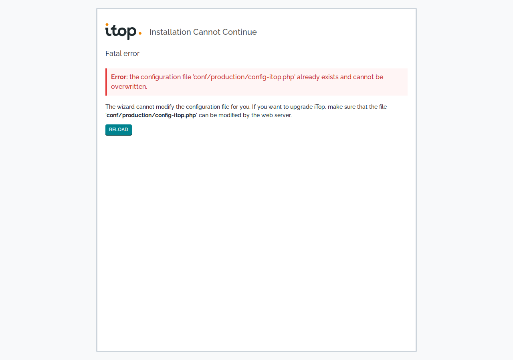

```sh
chmod u+w /var/www/itop/conf/production/config-itop.php
```

Open `https://itop.example.com/setup/`, log in as an administrator and choose **Upgrade an existing
iTop instance**. On the **Extensions** page, **tick Altioo OAuth Server** (and, with Keycloak,
**oAuth/OpenID authentication**). New extensions are **not** ticked by default on an upgrade.

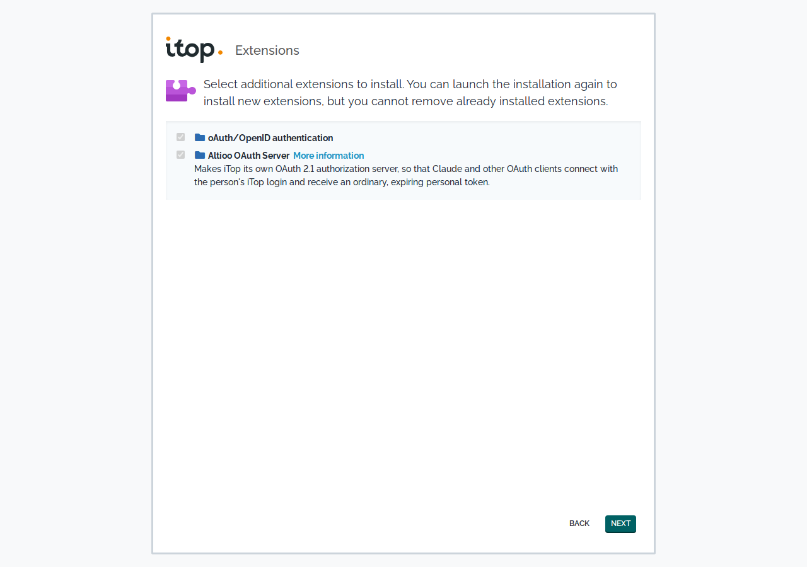

*In the test stack both extensions are already installed, so their boxes are greyed out. On your
iTop they are empty and you tick them.*

Finish the wizard.

### 3.3 Edit `config-itop.php`

The wizard makes the file read-only again. Make it writable, add the settings below, check the
syntax and make it read-only again:

```sh
chmod u+w /var/www/itop/conf/production/config-itop.php
# ... edit ...
php -l /var/www/itop/conf/production/config-itop.php   # must print "No syntax errors"
chmod 0440 /var/www/itop/conf/production/config-itop.php
```

In `$MySettings`:

```php
'allowed_login_types' => 'form|token',          // with Keycloak: 'form|token|hybridauth-Keycloak'
'allow_rest_services_via_tokens' => true,
```

In `$MyModuleSettings` (use your own profile names; **leave `Administrator` out**):

```php
'authent-token' => array(
	'personal_tokens_allowed_profiles' => array('Service Desk Agent', 'Support Agent'),
	'enable_myaccount_menu' => true,
),
'altioo-oauth-server' => array(
	'redirect_uris' => array('https://chat.example.com/api/mcp/itop/oauth/callback'),
	'allow_loopback' => false,
	'access_token_lifetime' => 3600,
	'grant_idle_days' => 30,
	'max_grant_days' => 90,
	'resources' => array(
		'itop-mcp' => array(
			'url' => 'https://mcp.example.com/mcp',   // EXACTLY MCP_RESOURCE_URL
			'label' => 'iTop assistant',
			'scope_prefix' => 'REST/JSON',
			'default_scopes' => array('REST/JSON'),
			'bearer_methods' => array('header'),
			'required_profiles' => array('Service Desk Agent', 'Support Agent'),
		),
	),
),
```

What each value means: [Configure iTop](setup/itop-prerequisites.md#configure-itop).

### 3.4 Web server rewrite

MCP clients look for iTop's OAuth metadata at the site root. Add this to the iTop Apache vhost (for
nginx see [Web server rewrites](setup/itop-prerequisites.md#nginx)):

```apache
RewriteEngine On
RewriteRule ^/?\.well-known/(oauth-authorization-server|openid-configuration)/env-production/altioo-oauth-server$ /env-production/altioo-oauth-server/index.php?route=$1 [PT,QSA,L]
```

If a reverse proxy terminates TLS in front of iTop, PHP must also see the public URL, or users land
on iTop's home page instead of the consent page later. See
[PHP behind a reverse proxy](setup/itop-prerequisites.md#php-behind-a-reverse-proxy).

## 4. Start the MCP server

Full details: [README → Install](../README.md#install).

```sh
git clone <repository URL> itop-mcp-server
cd itop-mcp-server
git checkout v0.1.0

cp .env.example .env
# set ITOP_BASE_URL=https://itop.example.com
# set MCP_RESOURCE_URL=https://mcp.example.com/mcp
${EDITOR:-vi} .env

mkdir -p logs && sudo chown 10001:10001 logs   # before the first start
docker compose up -d --build
docker compose ps                              # wait for "(healthy)"
```

Then point your reverse proxy at `127.0.0.1:8130` for the host `mcp.example.com`. It must pass the
`Host` and `Authorization` headers through unchanged. Examples for nginx and Apache:
[README → Reverse proxy](../README.md#reverse-proxy-tls).

## 5. Check the chain with curl

Run these against the **public** URLs. Each one builds on the one before.

```sh
# 1. iTop's OAuth metadata: JSON with "issuer": "https://itop.example.com/env-production/altioo-oauth-server"
curl -s https://itop.example.com/.well-known/oauth-authorization-server/env-production/altioo-oauth-server

# 2. The MCP server without a token: HTTP 401 with a www-authenticate header pointing to its metadata
curl -si -X POST https://mcp.example.com/mcp -H 'Content-Type: application/json' \
  -H 'Accept: application/json, text/event-stream' \
  -d '{"jsonrpc":"2.0","id":1,"method":"initialize","params":{}}' | head -n 20

# 3. The MCP server's metadata: "resource" is your MCP_RESOURCE_URL,
#    "authorization_servers" is the issuer from check 1
curl -s https://mcp.example.com/.well-known/oauth-protected-resource/mcp
```

Check 4 compares the resource URL in all three places. If a check fails, the table under it in
[the check list](setup/itop-prerequisites.md#check-list) names the cause.

## 6. Optional: log into iTop with Keycloak

Skip this section if users log into iTop with iTop's own login form. Full details:
[Example setup → Keycloak](setup/example-keycloak-librechat.md#keycloak-client-for-itop).

### 6.1 A Keycloak client for iTop

In the Keycloak admin console, realm `example`: **Clients** → **Create client**, client ID `itop`.
Turn **Client authentication** on and allow the **Standard flow** only:

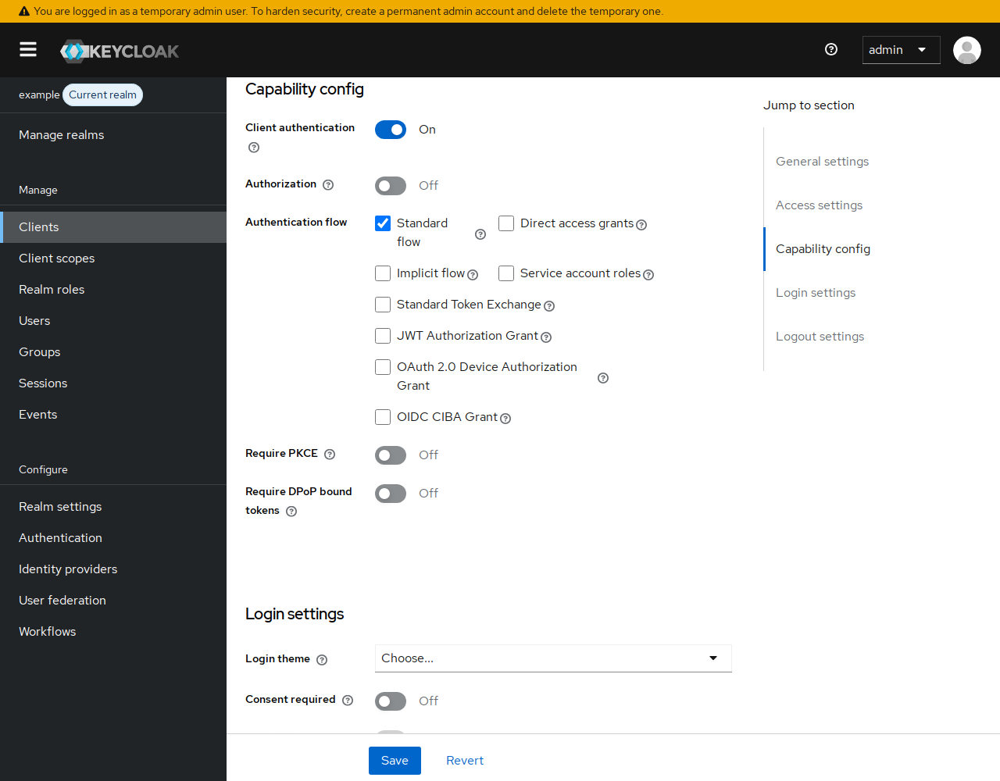

- **Direct access grants**: untick it (it is on by default).
- **Require PKCE**: off. The HybridAuth
  adapter does not send PKCE, so logins would fail with it on.
- **Valid redirect URIs**: exactly
  `https://itop.example.com/env-production/combodo-hybridauth/landing.php`, no wildcard.

Copy the **Client Secret** from the **Credentials** tab:

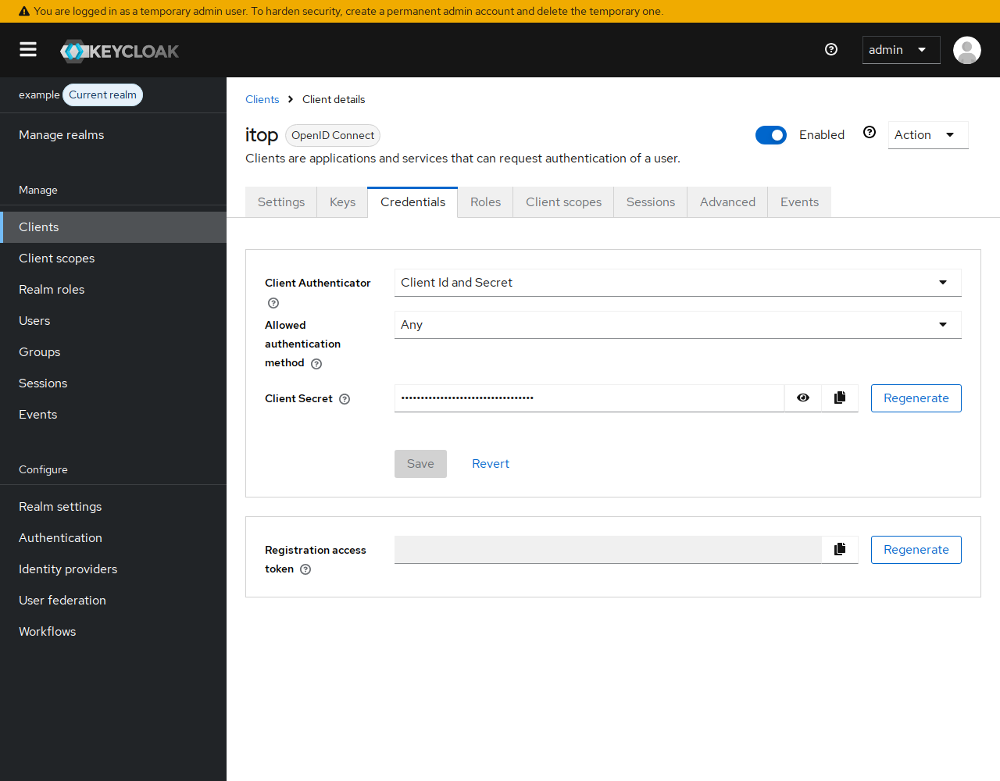

### 6.2 Lock down the email

iTop finds the user by the email Keycloak returns. Whoever can change their own email in Keycloak
could log into iTop as someone else. In **Realm settings** → **User profile** → `email`, untick
**User** under **Who can edit?**, and turn on **Verify email** under **Realm settings** → **Login**:

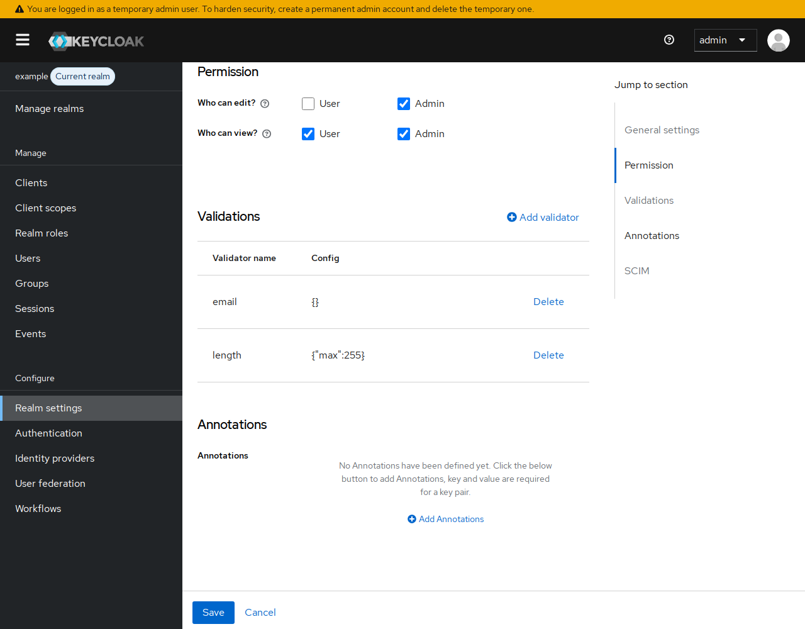

### 6.3 Tell iTop about Keycloak

In `config-itop.php`, add `hybridauth-Keycloak` to `allowed_login_types` (keep `form` first) and
replace the `combodo-hybridauth` block the wizard wrote with the one in
[the example setup](setup/example-keycloak-librechat.md#combodo-hybridauth-in-mymodulesettings),
with your Keycloak URL, realm and client secret.

For every user, create an **External user** in iTop whose **login is exactly their Keycloak
email**, with an agent profile from `required_profiles`. iTop's login page then offers the
Keycloak button:

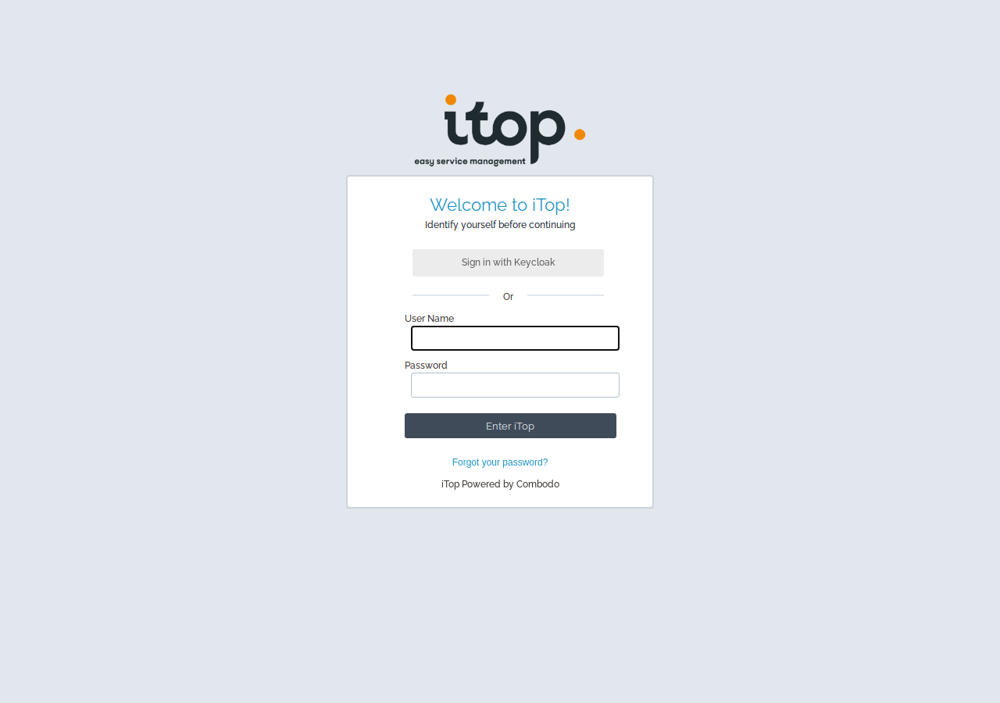

## 7. Connect LibreChat

Full details: [Example setup → LibreChat](setup/example-keycloak-librechat.md#librechat).

Add to `librechat.yaml` (keep everything else in the file) and restart LibreChat:

```yaml
mcpServers:
  itop:
    type: streamable-http
    url: https://mcp.example.com/mcp        # exactly MCP_RESOURCE_URL
    title: iTop
    description: Tickets, CIs and contacts from iTop, with your own iTop rights
    requiresOAuth: true                     # no "oauth:" block: LibreChat finds iTop by itself

mcpSettings:
  allowedDomains:
    - "https://mcp.example.com"
    - "https://itop.example.com"            # both hosts, or OAuth fails on private IPs

modelSpecs:
  list:
    - name: itop-assistant
      label: iTop assistant
      description: Answers questions about iTop with your own iTop rights
      preset:
        endpoint: <your endpoint>           # a model that supports tool calls
        model: <your model>
      mcpServers:
        - itop
```

The server name `itop` is part of LibreChat's callback
(`https://chat.example.com/api/mcp/itop/oauth/callback`), which must be in `redirect_uris` in iTop
(step 3.3). To start every new chat with the iTop assistant, see
[iTop assistant preselected](setup/example-keycloak-librechat.md#librechatyaml-the-itop-mcp-server).

For logging into LibreChat with Keycloak (a second Keycloak client `librechat` and a few `.env`
keys), follow [the example setup](setup/example-keycloak-librechat.md#keycloak-client-for-librechat).

## 8. First connection and first question

Do this once yourself as a test user with an agent profile, in a private browser window. Each user
goes through it once; after that, LibreChat renews the token in the background.

**1. Open the MCP servers.** In LibreChat, click the **MCP Settings** icon in the left bar. **iTop**
has an orange dot: not connected yet. Click the **Connect** icon (the plug) next to it.

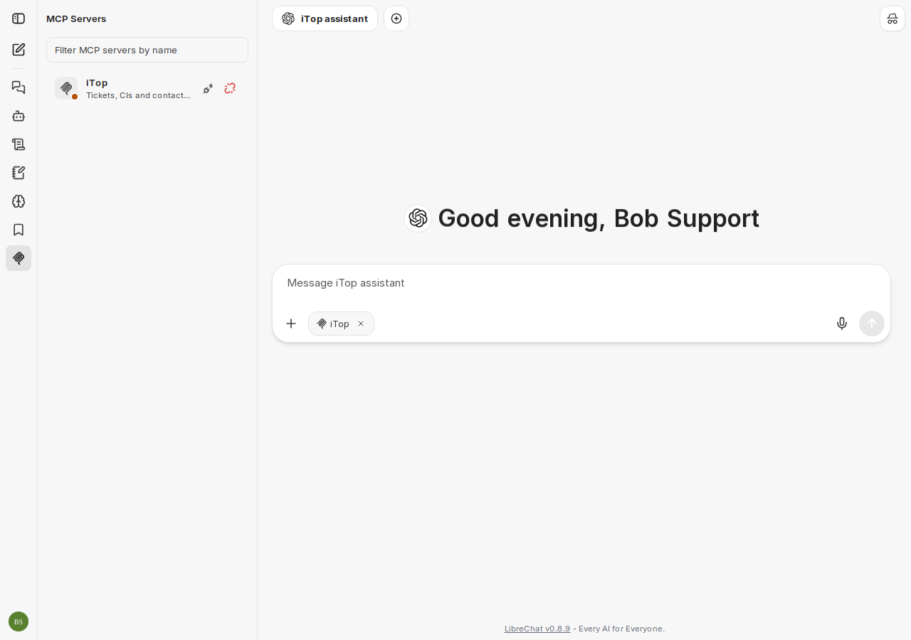

**2. Start the OAuth flow.** LibreChat shows the iTop link. Click **Continue with OAuth**. A new
tab opens with iTop's login page; log in (with Keycloak: **Sign in with Keycloak**).

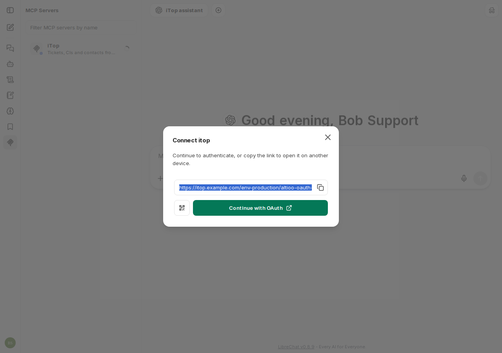

**3. Give consent in iTop.** iTop names the iTop user, where it sends you back (`chat.example.com`)
and the resource (**iTop assistant**, `https://mcp.example.com/mcp`). Click **Allow**. The tab
closes by itself.

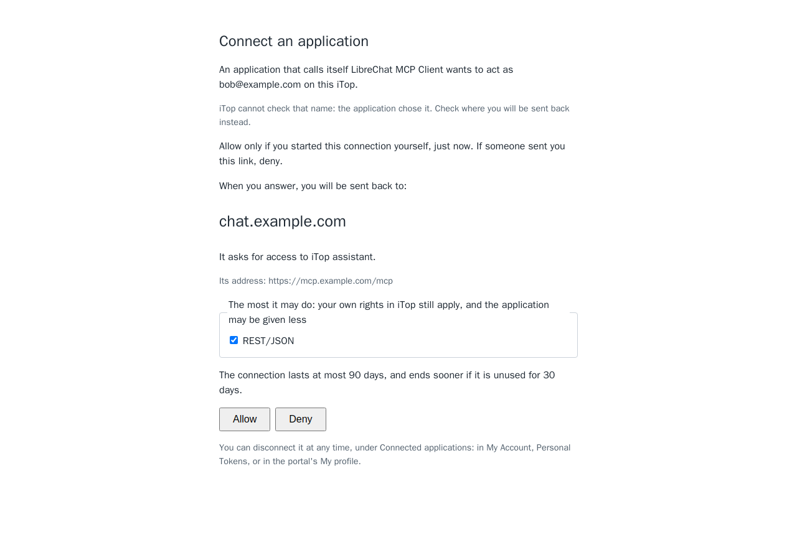

If you land on iTop's home page instead of this page, or iTop says "Unknown resource", see
[section 10](#10-when-something-goes-wrong).

**4. Connected.** The dot next to **iTop** turns green.

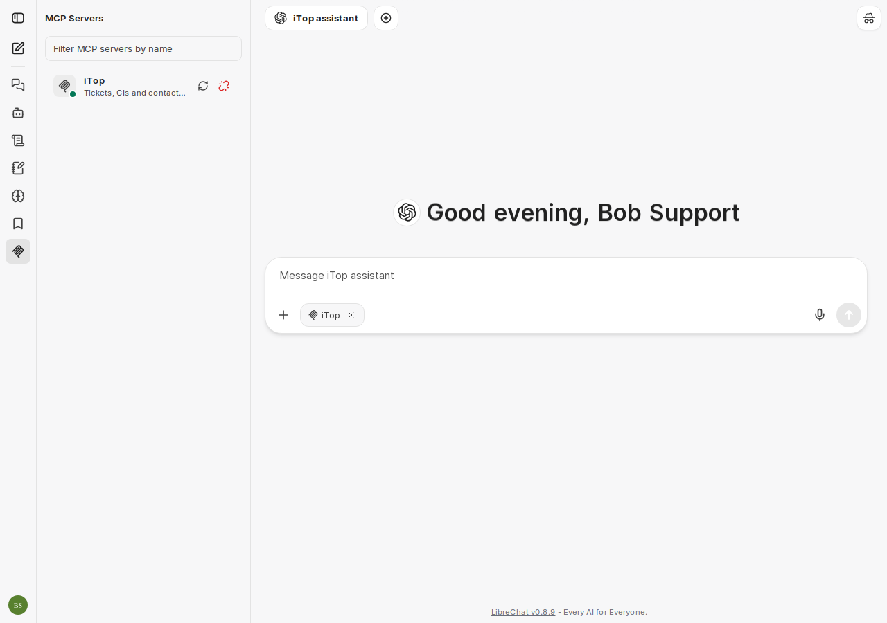

**5. Ask who you are.** Start a new chat with the **iTop assistant** and ask:

> Use the whoami tool: who am I in iTop?

The assistant runs the `whoami` tool and names the iTop person behind your account:

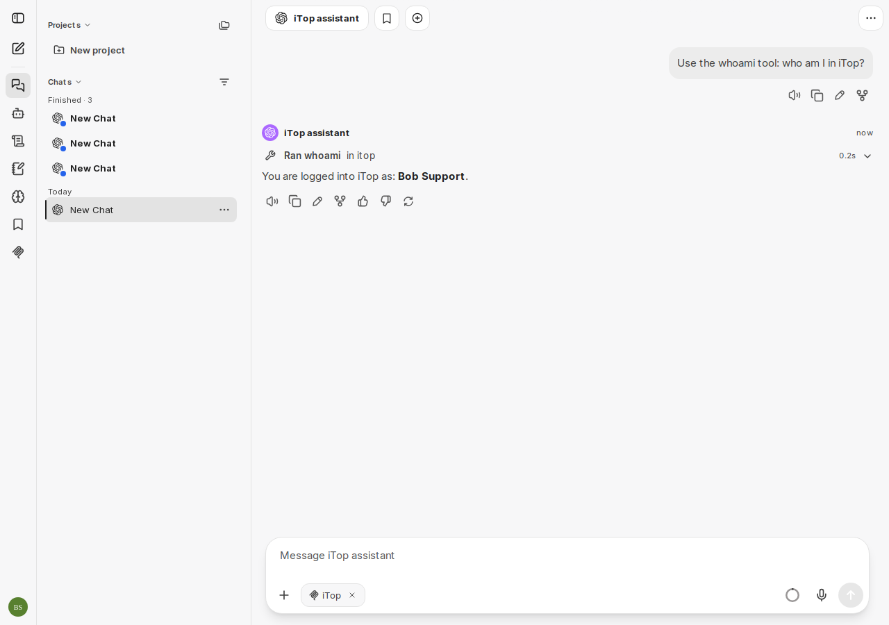

Repeat with a second user: the answer must name that user. From now on the assistant reads exactly
what this iTop user may read, and nothing more.

If a user asks a question before connecting, LibreChat shows a sign-in button right in the chat,
which starts the same flow:

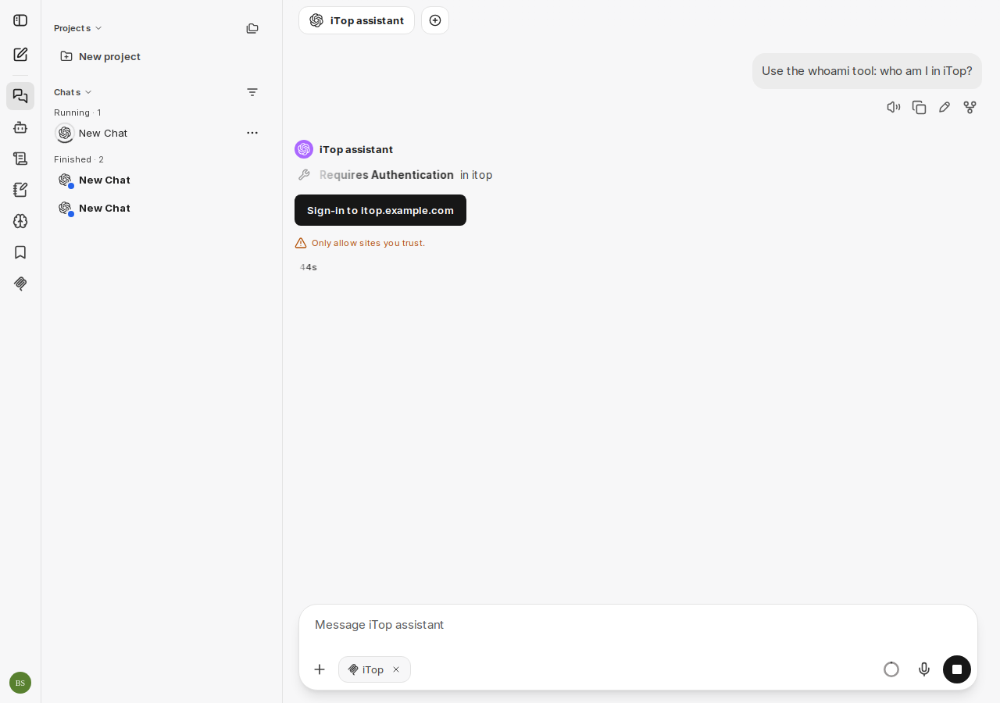

## 9. Day-to-day operation

**Your users.** Hand them the [user guide](user-guide.md): logging in, connecting once, asking good
questions, disconnecting. Replace the example addresses in it with yours.

**Who is connected.** In iTop, **Admin tools** → **OAuth connections** lists every active
connection, with user, client, resource and end date. Users see their own under **My Account** →
**Personal Tokens** → **Connected applications** and can end them there.

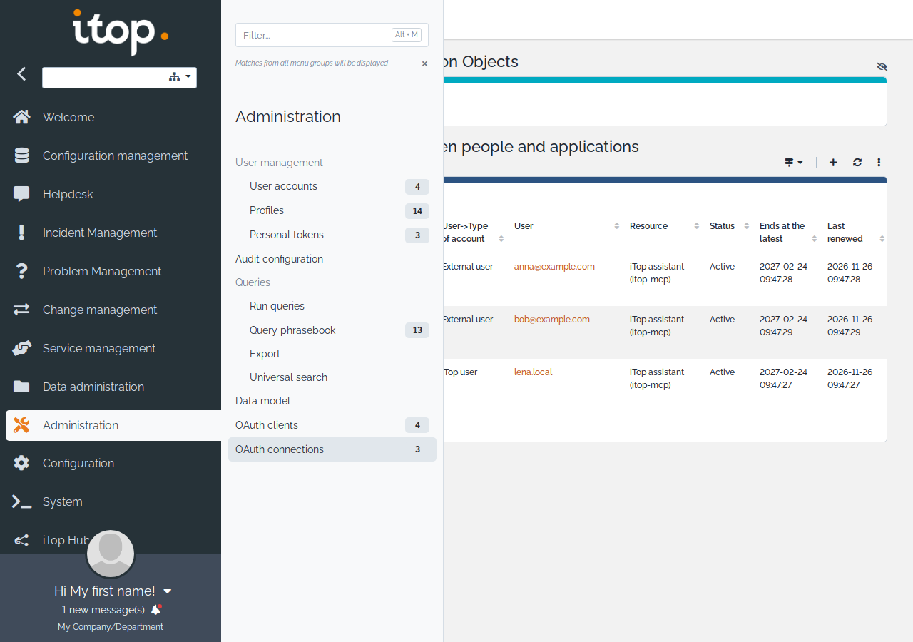

**Ending access.**

- A user disconnects in LibreChat with **Revoke** (next to **Connect**, see step 8.1) or in iTop.
- Disabling the iTop user stops their assistant access within one hour (`access_token_lifetime`).
- Every connection ends after 90 days, or after 30 days without use, and the user consents again.

**Audit log.** Every tool call writes one JSON line to `logs/mcp-itop-audit.log` on the Docker
host, with the iTop user, the tool and its arguments, never the token. Rotate it with logrotate
(`copytruncate`). Details: [README → Audit log](../README.md#audit-log).

**Updates.** `git fetch --tags && git checkout vX.Y.Z && docker compose up -d --build`. The server
keeps no state; rolling back is the same with the previous tag. Details:
[README → Update and rollback](../README.md#update-and-rollback).

## 10. When something goes wrong

| Symptom | Most likely cause | Details |
|---|---|---|
| Container restarts in a loop | `./logs` not owned by UID 10001, or a value missing in `.env` | [README → Troubleshooting](../README.md#troubleshooting) |
| iTop says **"Unknown resource"** | The resource URL differs between `.env`, `config-itop.php` and `librechat.yaml` | [Check 4](setup/itop-prerequisites.md#4-the-resource-url-matches-in-all-three-places) |
| After login you land on iTop's **home page**, not the consent page | PHP does not see the public URL behind the reverse proxy | [PHP behind a reverse proxy](setup/itop-prerequisites.md#php-behind-a-reverse-proxy) |
| LibreChat fails before any iTop page, log mentions a **private IP** | `allowedDomains` lacks one of the two hosts | [Example check 6](setup/example-keycloak-librechat.md#6-connecting-the-itop-server-opens-the-itop-consent-page) |
| LibreChat cannot register with iTop | Its callback is not in `redirect_uris` | [Example check 6](setup/example-keycloak-librechat.md#6-connecting-the-itop-server-opens-the-itop-consent-page) |
| User refused before the consent page | The iTop user has none of the `required_profiles` | [Check 5](setup/itop-prerequisites.md#5-an-mcp-client-can-connect) |
| Consent works, but LibreChat never shows connected; `docker logs` says `Token abgelehnt` | `token` missing in `allowed_login_types`, or `allow_rest_services_via_tokens` not `true` | [Check 5](setup/itop-prerequisites.md#5-an-mcp-client-can-connect) |
| Tool calls fail with **421** | The reverse proxy does not pass the public `Host` header | [README → Reverse proxy](../README.md#reverse-proxy-tls) |
| Keycloak: "Invalid parameter: redirect_uri" | Redirect URI in the Keycloak client is not exact | [Example check 3](setup/example-keycloak-librechat.md#3-a-keycloak-user-logs-into-itop) |
| iTop: "User not allowed" after Keycloak | No enabled External user with the Keycloak email as login | [Example check 3](setup/example-keycloak-librechat.md#3-a-keycloak-user-logs-into-itop) |
